<div align="center">



**三个配套的京东 Cookie 工具 · 一站式 `提取 ▸ 校验 ▸ 上传青龙`**

[](https://github.com/qq329192/jd-ck-tools/releases)
[](https://github.com/qq329192/jd-ck-tools/releases/tag/lsp-v1.40.0)
[](https://github.com/qq329192/jd-ck-tools/releases/tag/capture-v1.10.2)
[](https://github.com/qq329192/jd-ck-tools/releases/tag/push-v1.0.0)
[](#️-重要提醒)

</div>

---

## 📦 包含的 App

| App | 应用名 | Tag 前缀 | 说明 |
|---|---|---|---|
| **JdCookieLsp** | 豆豆管家 | `lsp-v*` | LSPosed 插件。注入京东进程直接读取 CookieStore（支持 root LSPosed 与 LSPatch 无 root 双框架），支持多账号。v1.33 起内置**脚本仓库**（20+ 京东活动脚本，云端一键更新）、**日志折叠与一键分享反馈**、**测试版通道自选**。v1.35+ 新增：**呆呆面板支持**、**设备指纹全自动采集**（UA/uuid/eid/wg-sdk-token 自动抓、随账号写面板 cache/accounts，失效自动换新）、**桌面小组件**（磨砂透明卡、京东头像、今日获取京豆、↻ 手动刷新、单号/汇总双模式）、**多账号管理页**。 |
| **JdCkCapture** | JD CK 抓取器 | `capture-v*` | VPN 抓取器。基于 hev-socks5-tunnel + 本地 CA 解密京东流量，自动从 WebView 请求中提取 `pt_key`/`pt_pin` 并写入青龙面板，也可一键复制。**不需要 root**。 |
| **JdQlPush** | 青龙推送器 | `push-v*` | 手动提交/校验 CK 并推送到青龙面板，含失效检测。 |

## 📥 下载

到 [**Releases**](https://github.com/qq329192/jd-ck-tools/releases) 页面按 Tag 前缀找对应 App 的 APK。

| App | 最新版本 | 发布日期 | Tag |
|---|---|---|---|
| 豆豆管家 | **v1.40.0** | 2026-11-19 | [`lsp-v1.40.0`](https://github.com/qq329192/jd-ck-tools/releases/tag/lsp-v1.40.0) |
| JdCkCapture | v1.10.2 | 2026-10-26 | [`capture-v1.10.2`](https://github.com/qq329192/jd-ck-tools/releases/tag/capture-v1.10.2) |
| JdQlPush | v1.0.0 | 2026-10-26 | [`push-v1.0.0`](https://github.com/qq329192/jd-ck-tools/releases/tag/push-v1.0.0) |

## 🔄 自动更新

三个 App 启动时会静默查询本仓库的 Releases API：

```bash
# 更新器工作流（伪代码）
filter  releases by tag_prefix        # 如 lsp-v1.39.4
compare versionName vs latest         # 正式版 / beta 精确分序
notify  → 弹窗「发现新版本」→ APK 直链
```

只要在 GitHub 上发新 Release，手机端下次打开就会收到提醒。

> **🧪 测试版通道**（豆豆管家 v1.33.0 起支持）
> 收到测试版弹窗时可自行选择 **「加入测试通道」/「仅下载一次」/「不加入」**——
> 不加入则永远只收正式版提醒，互不打扰。

## 💡 使用提示

<details open>
<summary><b>🟢 豆豆管家（JdCookieLsp）</b></summary>

- **root 用户**：LSPosed 勾选模块 + 作用域选京东，强停京东后生效
- **无 root**：可用 LSPatch 修补京东（内置/便携模式 + 嵌入本模块，签名绕过选 `pm+openat`），或使用 App 内「H5 登录提取」「手动粘贴 Cookie」两条免 root 通道
- 运行日志支持重复行折叠，点「分享」可一键把日志（自带版本/机型/系统信息）发给开发者反馈问题
- **桌面小组件**（v1.37+）：长按桌面添加「豆豆管家」——磨砂透明卡显示京东头像/昵称/CK 状态/京豆/**今日获取京豆**；右上角 ↻ 或点头像手动刷新，30 分钟自动刷
- **多账号管理**：App「账号管理」页可实时查所有账号 CK + 京豆，一键把卡片切到指定账号（单号模式）或恢复全部汇总
- **指纹同步**（v1.36+）：打开京东页面自动抓 UA/uuid/eid/wg-sdk-token 等写面板 `cache/accounts/<pt_pin>.json`，JDOOK 脚本免手动抓包；「同步策略」页可关。v1.39.6 起推送改为**字段级合并**：面板上人工校准的字段（金融指纹 `extra.fin_*`、area、坐标等）不会被本机快照冲掉
- **H5 登录提取**（免 root）：内置 WebView 走 `appid=100` 登录，拿 `app_open…` 开头的 **App CK（pt_key/pt_pin）**，写 `JD_COOKIE`。与模块在京东进程里读到的是同一种，**不是网页版 thor**。v1.39.9 起移除网页 CK 提取入口（WEBJD_COOKIE 需在面板手工填）
- **面板提示**（v1.39.8+）：所有"写入青龙"文案改为按实际配置动态显示「呆呆面板/青龙」，配呆呆不再误显示青龙

</details>

<details>
<summary><b>🔵 JdCkCapture</b></summary>

- 首次使用需安装其生成的 CA 证书（应用内引导）
- Android 14+ 系统证书需 root 推入系统证书目录，普通用户证书可抓大部分流量

</details>

<details>
<summary><b>🟡 通用</b></summary>

- 三个 App 抓取的 CK 格式统一为 `pt_key=xxx;pt_pin=xxx;`，可直接用于青龙 `JD_COOKIE`

</details>

## 📊 仓库动态

<div align="center">
  
  
</div>

## ⚠️ 重要提醒

> [!WARNING]
> **请使用你自己搭建的青龙面板** —— Cookie 等同账号登录凭证，不要填入任何他人提供的服务器地址。

> [!IMPORTANT]
> **仅供学习交流**，使用本工具产生的一切账号风控、封禁风险由使用者自行承担。
> 请勿将本工具用于商业用途或二次分发收费。

---

<div align="center">

```
┌─────────────────────────────────────────┐
│  if ( this.repo.helped_you )  star ⭐   │
└─────────────────────────────────────────┘
```

**如果这个项目对你有帮助，欢迎点个 ⭐ Star**

</div>
